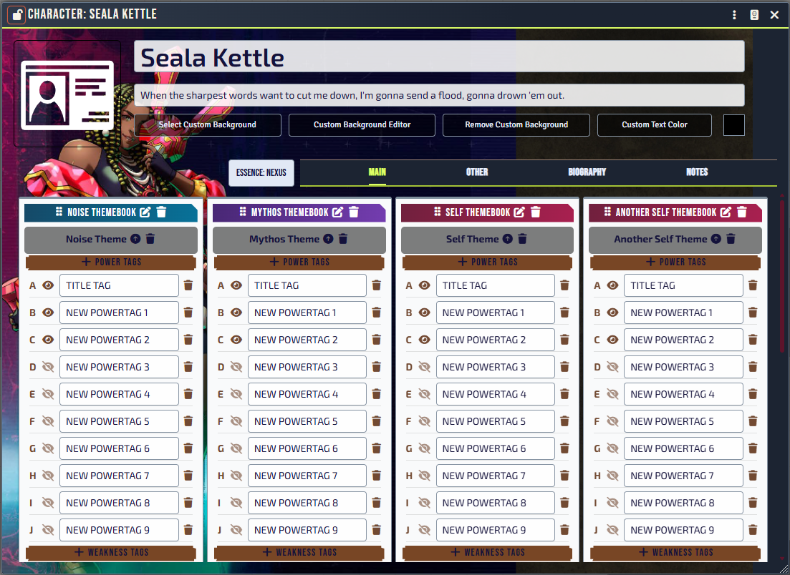
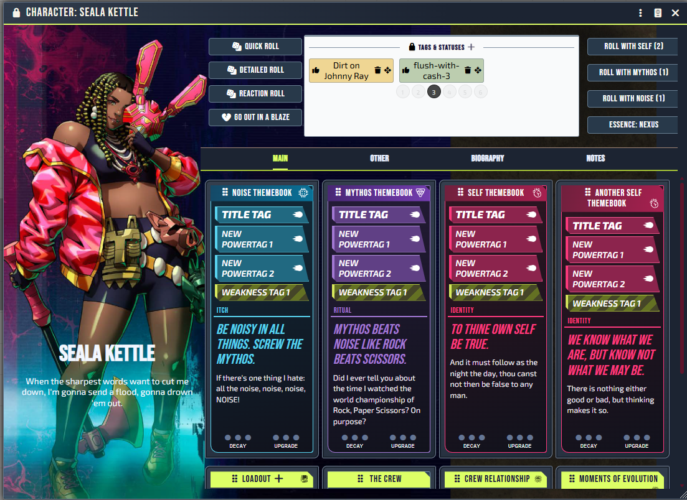
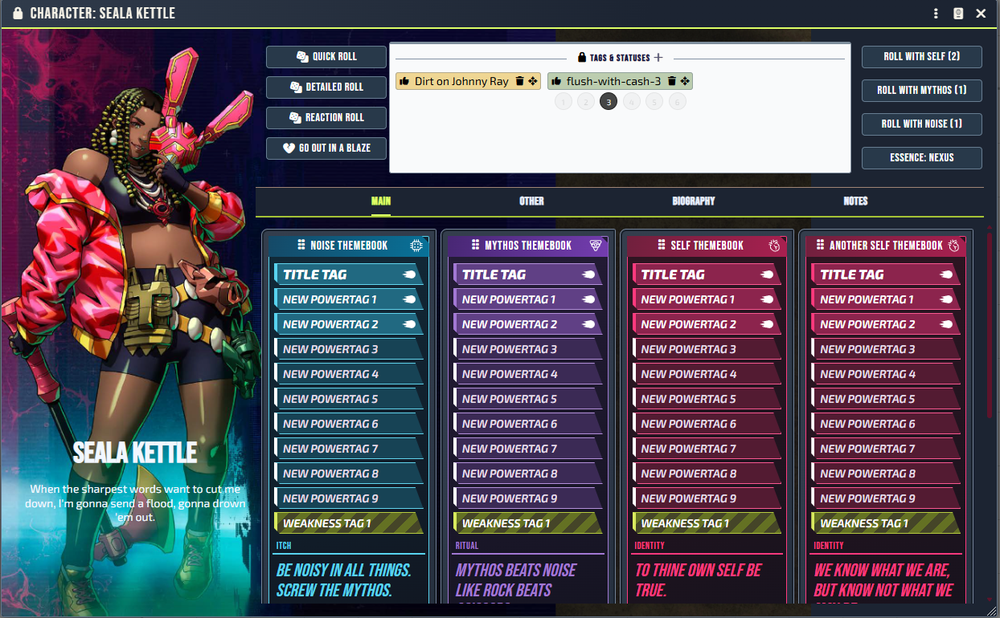
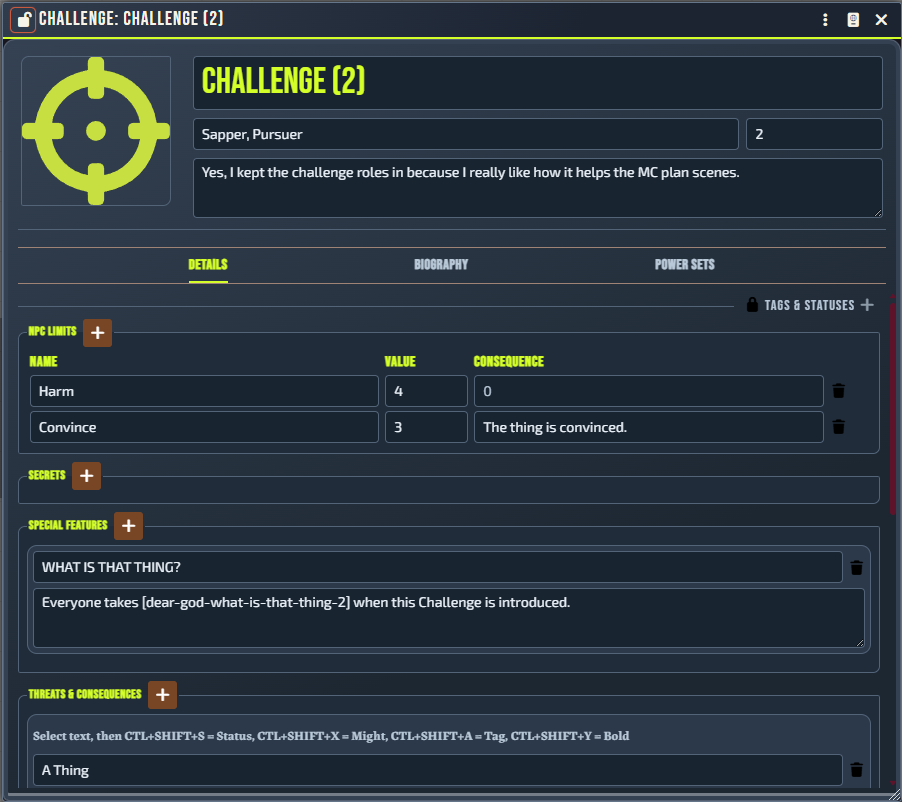
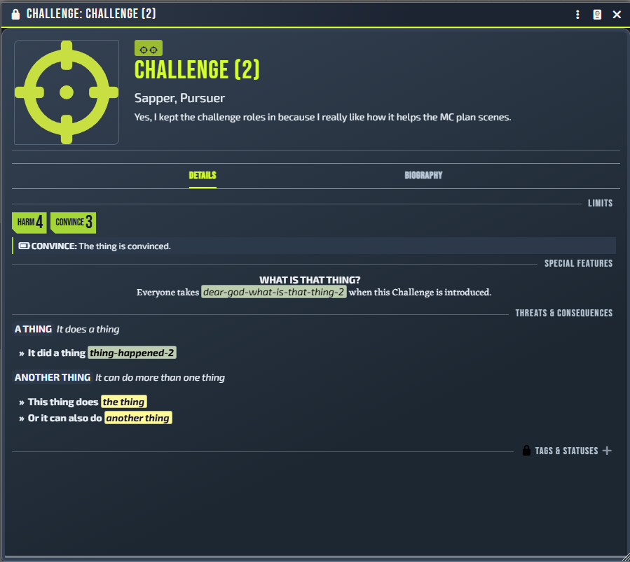
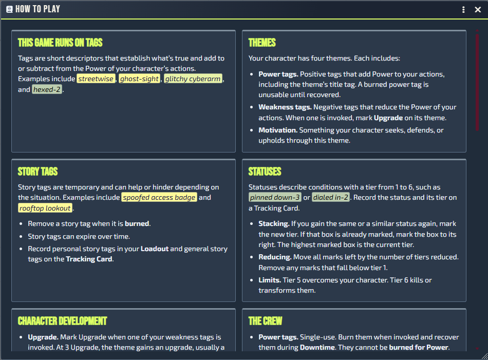

# :Otherscape — Mist Engine Reskin

Unofficial Foundry add-on for Foundry VTT 14 and the `mist-engine-fvtt` game system. The stylesheet and localization keys were developed against Mist Engine 14.5.5.

# Images
## Character Sheet

	
Click to expand

### Unlocked

### Locked (TidyTags option enabled)

### Locked (TidyTags option disabled)

## Challenge Sheet

	
Click to expand

### Unlocked

### Locked

## How to Play Dialog

	
Click to expand

# Install

1. Extract the ZIP into your Foundry user data folder's `Data/modules` directory. The manifest should be at `Data/modules/otherscape-mist-skin/module.json`.
2. Restart Foundry after copying the module folder. Open your Mist Engine world, go to **Settings → Manage Modules**, and enable **:Otherscape — Mist Engine Reskin**.
3. Use the English client language for the terminology overrides. Disable the module and reload to revert the presentation.

# World landing page

The module includes a widescreen Metro :Otherscape join-page background. From Foundry Setup, open **Game Worlds → Edit World** for your :Otherscape world. Set **Background Image** to `modules/otherscape-mist-skin/assets/landingpage.webp` and save.

Foundry reads the join-page background from the world configuration before it loads the world's enabled modules. Set the background once per world. Thi also preserves any custom landing page you have already configured.

# Customize

- **`styles/otherscape.css`** contains the palette, fonts and scoped selectors for the sheets, roll and tracker dialogs and scene tags. The Otherscape Garage Style Guide informs the lime headings, slate card frames, scanline texture and inline highlight colors. Bebas Neue, Exo 2 and IBM Plex Mono are bundled under the SIL Open Font License.
- **`styles/chat.css`** applies the guide’s page 5 side box in light mode and page 13 negative side box in dark mode. It uses the page 11 outcome badges, including a combined reticle and burst for mixed success.
- **`styles/theme-categories.css`** swaps the Origin, Adventure and Greatness slots for the page 27 Noise, Mythos and Self icons and adds blue, purple and red character-card banners. The extracted icons are from the Son of Oak Game Studio *Otherscape Garage Style Guide*.
- **`styles/locked-theme-cards.css`** styles locked character theme cards using Foundry’s light or dark theme and places the existing burn control on the right.
- **`lang/en.json`** contains English overrides keyed to the upstream system. This is a partial dictionary. Add or revise entries using the same key paths as Mist Engine’s `lang/en.json`. Preserve any interpolation placeholders, such as `{name}`, exactly.
- **`module.json`** registers both files through Foundry’s native module loading. Both files ship in this add-on, so there is no need to edit the installed system.

For custom journal text, use `<mark class="location">…</mark>` or `<mark class="triggered-scene">…</mark>` for the guide’s blue highlights. Ordinary links keep Foundry’s styling. In play mode, card banners follow the theme type. Edit mode uses the existing Color setting, which defaults to the type. The Theme Kit and Themebook Type menus offer separate OS - Noise, OS - Mythos and OS - Self options. These save as `os-noise`, `os-mythos` and `os-self`. The Type menus hide LitM choices except for the current value on an item already using a LitM type. Existing LitM types keep their established visual aliases until the item is changed. Importing a Theme Kit as a new theme carries over its type. Assigning a kit to an existing theme keeps the receiving theme’s type.

# Terminology and rules

The character sheet presents Backpack as **Loadout**, Fellowship as **Crew**, Quest as **Motivation** (Identity / Ritual / Itch), Improve as **Upgrade**, and Abandon as **Decay**. These labels use the existing Mist Engine fields. The Loadout is the stock tag container. For a full Loadout Theme with a flaw and specials, track it separately using a regular theme card or your own sheet.

Use the :Otherscape rules at the table for Self, Mythos, Noise, Essence, Scale, and any differences in loadout, advancement, downtime or rolls. The in-app rules reference, compendium contents and text written directly into system templates or existing documents can still show Legend in the Mist terminology. Existing actor and item data stay in their original format. Another English localization add-on overriding the same keys can affect which wording appears.

References: [Mist Engine 14.5.5 source](https://github.com/MrTheBino/mist-engine-fvtt/tree/14.5.5), [Son of Oak’s :Otherscape page](https://sonofoak.com/pages/otherscape), and [Foundry’s localization documentation](https://foundryvtt.com/article/localization/).

# Rolling with a category

On a locked character sheet, Roll with Self, Mythos or Noise opens a separate roll dialog. The number shown on each button is the character’s count of non-story themes in that category. The roll uses that count instead of positive tags, keeps negative tags and statuses, and offers Quick, Detailed and Reaction resolution. The normal MC confirmation setting also applies. Positive helping tags are excluded from category rolls.

Category rolls cannot burn tags. Completing one clears pending burn marks as the roll selections reset. The MC decides whether general affinity applies to the attempted action.

# License

This product was created under license. **:Otherscape** and its logo are trademarks of Son of Oak Game Studio LLC. All **:Otherscape** setting material, art, and trade dress are the property of Son of Oak Game Studio LLC.

This work contains material that is copyright of Son of Oak Game Studio LLC and/or other authors. Such material is used with permission under the Community Content Agreement for The Cauldron of Mist.

All other original material in this work is copyright 2026 by Trevor W. Schadt and published under the Community Content Agreement for The Cauldron of Mist.